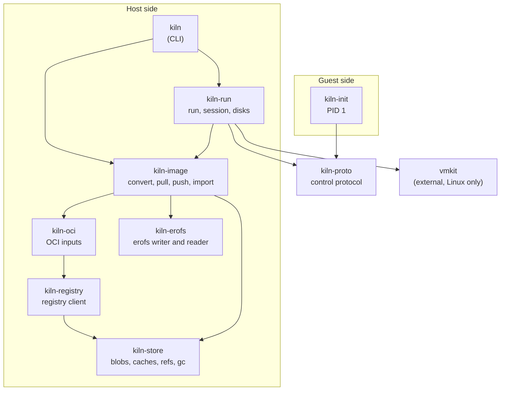
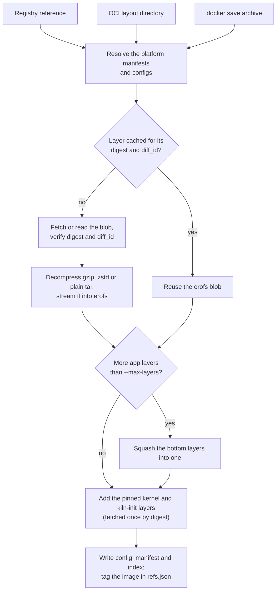
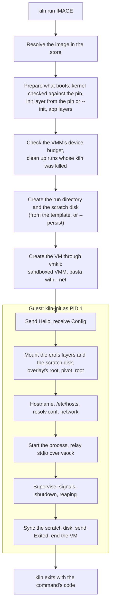
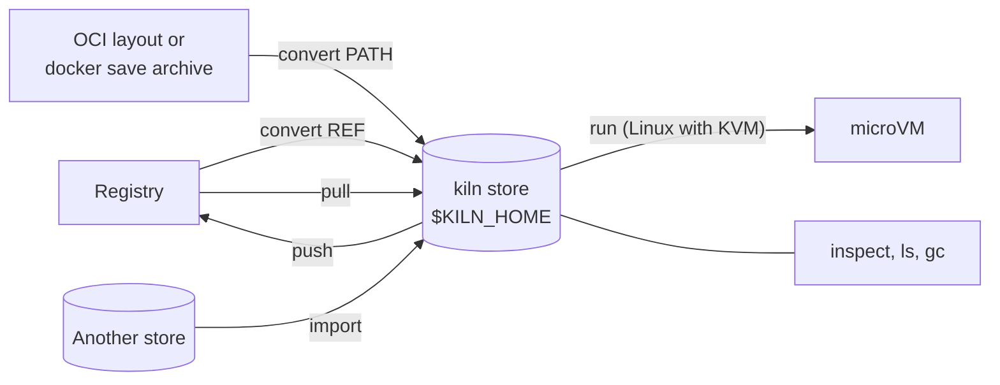

# kiln

kiln turns OCI container images into microVM images and runs them. Each OCI layer becomes one deterministic, read-only erofs filesystem, written by kiln's own Rust erofs writer straight from the layer's tar stream; inside the guest, kiln's own init (`kiln-init`) stacks those layers with overlayfs over a writable ext4 scratch disk and runs the image's command. Converting, pulling, pushing and inspecting images runs natively on Linux and macOS without root. `kiln run` boots images under Firecracker or Cloud Hypervisor through [vmkit](https://github.com/AlfonsoCampodonico/vmkit), on Linux with KVM (on macOS, in a Lima VM), also without root.

The point is per-layer caching and dedupe for microVM root filesystems, a stable documented image format ([docs/format.md](docs/format.md)), and a run path that treats both images and guests as untrusted.

## Status

kiln is at milestone M3b. There are no releases yet; build from source.

| Area | Status |
|---|---|
| `kiln convert` from registries, OCI layouts and `docker save` archives | Works on Linux and macOS |
| erofs writer and reader, per-layer cache, bottom-layer squash | Works; erofs profile version 1, golden digests are immutable |
| `pull`, `push`, `import`, `inspect`, `ls`, `gc` | Works |
| `kiln run` on Firecracker | Works on Linux with KVM; the reference VMM |
| `kiln run` on Cloud Hypervisor | Works, with known limits: online disk growth beyond about 8 GiB hangs, and guests sometimes stall under nested virtualization |
| `kiln run` on macOS | Through the Lima VM in `lima/kiln.yaml` (Apple M3 or later, macOS 15 or later) |
| Networking (`--net`, `--egress`, `-p`) and persistent disks (`--persist`) | Works |
| Pinned kernel | vmkit's `base` 6.18.54 for arm64 and amd64, added by `kiln convert` |
| Pinned kiln-init | Not yet: no kiln-init release exists, so `kiln run` needs `--init PATH --allow-custom-init` |
| A containerd shim (`containerd-shim-kiln-v1`, RuntimeClass `kiln`) | v1: one container VM per pod at a time on the pod IP, logs, exit codes and stop; no exec or volumes yet ([kubernetes.md](docs/kubernetes.md)) |
| `kiln build`, services in kiln-init | Designed in the [spec](docs/superpowers/specs/2026-09-30-kiln-design.md), not implemented |

## Quick start

Convert and inspect images (Linux or macOS):

```bash
cargo install --path crates/kiln

# From a registry (Docker Hub here): only layers that are not cached are downloaded.
kiln convert php:8.4-cli --platform linux/arm64 --platform linux/amd64
kiln inspect php:8.4-cli

# Or a local OCI layout or `docker save` archive (Docker 25+ writes OCI-in-tar;
# drop --platform if your Docker's `save` doesn't have it).
docker save --platform linux/arm64 php:8.4-cli -o php.tar
kiln convert --platform linux/arm64 --tag php:8.4-cli php.tar

kiln ls
kiln gc
```

Run one (Linux with KVM, Firecracker and vmkit's `vmkit-sandbox` helper installed; see [docs/running.md](docs/running.md)). Until a kiln-init is released, build one ([docs/testing.md](docs/testing.md#building-kiln-init)) and name it:

```bash
# On an aarch64 host, use target/aarch64-unknown-linux-musl instead.
K="--init target/x86_64-unknown-linux-musl/release/kiln-init --allow-custom-init"
kiln convert alpine:3
kiln run $K alpine:3 -- sh -c 'echo hello'
kiln run $K -t -i alpine:3                      # Ctrl-] q stops the guest, Ctrl-] k kills it
```

## Concepts

- **kiln image.** An OCI 1.1 artifact (`artifactType` `application/vnd.kiln.image.v1`): a manifest per platform, under an index when there are several, whose layers are a kernel, an init layer and the app layers, plus a small config with the process (entrypoint, cmd, env, user, working directory, stop signal). Specified in [docs/format.md](docs/format.md).
- **One erofs per OCI layer.** Each OCI layer tar is converted to an erofs image without being extracted, so conversion works on macOS filesystems that cannot hold Linux ownership or device nodes. Output depends only on the tar, inherited attributes and the format version, so the same input gives the same bytes on any host.
- **Implicit parents.** A directory a layer creates only because a descendant needs it inherits its attributes from the layers below it, as containerd does. Such a layer is marked `dev.kiln.inherits` and is cached against the attributes it inherited.
- **Squash.** Every app layer becomes a virtio-blk disk at run time, so `--max-layers` (default 10) bounds them: with `n` app layers and `n > N`, the bottom `n - N + 1` are squashed into one.
- **Boot layers and pins.** kiln compiles in the digests of the kernels and kiln-init binaries it trusts. `kiln convert` adds the pinned ones; `kiln run` boots an image's kernel only if it matches the pin and always supplies the init layer itself. An image without boot layers is *provisional*.
- **Scratch disk.** A writable ext4 disk per run, created from a reproducible template embedded in kiln and grown by the guest at boot. It holds the overlay's upper directory; `--persist PATH` keeps it across runs.
- **Store.** `$KILN_HOME` (default `~/.local/share/kiln`): content-addressed blobs, conversion caches and a `refs.json` of names. Everything is verified by digest before it is stored.
- **kiln-init.** A static musl PID 1 that mounts the layers, sets up the guest much as Docker sets up a container, runs the command and talks to the host over a framed, schema-validated vsock protocol.

## Architecture



The workspace's crates and their main dependencies (some direct edges, such as the CLI's to the lower crates, are left out). `kiln-testguest` is a hostile guest used only by the boot tests.

| Crate | Role |
|---|---|
| `kiln` | The CLI. Every string from an image is sanitised before it is printed. |
| `kiln-image` | The OCI to kiln conversion pipeline, the image format, inspect, import, registry convert, pull and push, the init layer and the scratch disk. |
| `kiln-erofs` | Deterministic erofs writer and reader for kiln's erofs profile; parent inheritance and squash over merged views. |
| `kiln-oci` | OCI types and verified inputs: registries, OCI layouts and `docker save` archives. File names, `index.json` and `manifest.json` are never trusted. |
| `kiln-registry` | A minimal OCI distribution client: Docker credentials, verified blob fetches, redirect and address rules ([docs/registries.md](docs/registries.md)). |
| `kiln-store` | The local store: content-addressed blobs, conversion caches, refs, a store-wide lock and garbage collection. |
| `kiln-run` | The host side of `kiln run`: preparing what boots, run directories, scratch and persisted disks, the protocol session, stdio, the terminal and signals. Boots VMs through vmkit on Linux. |
| `kiln-proto` | The control protocol between kiln-init and the host: framing, messages, validation. |
| `kiln-init` | The guest's PID 1. |
| `kiln-testguest` | Hostile guest programs for the boot tests. |

### Image pipeline



What `kiln convert` does, per platform. A warm convert of an unchanged image makes one manifest HEAD request and reuses every layer; changing a base layer reconverts only the layers that inherit attributes from it.

### Run flow



One `kiln run`, from the host's setup to the guest's seven boot stages. The protocol messages are in [docs/running.md](docs/running.md#what-a-run-does) and specified in [docs/format.md](docs/format.md#control-protocol-version-1).

## Command reference



How the commands move images between registries, local sources, stores and microVMs. `convert` reads OCI images; `pull` and `push` move kiln images.

| Command | What it does |
|---|---|
| `kiln convert PATH\|REF` | Converts an OCI image into a kiln image in the store. |
| `kiln pull REF [--tag NAME]` | Downloads a kiln image (an index of at most 8 platforms), verifying every blob. |
| `kiln push NAME REF` | Uploads a kiln image; blobs the registry already has are skipped. |
| `kiln import --from-store DIR NAME [--as NAME]` | Copies an image from another, possibly read-only, store, verifying every blob. |
| `kiln inspect NAME [--json]` | Shows an image's platforms, process, provenance, boot layers and layers. |
| `kiln ls [--json]` | Lists tagged images. |
| `kiln gc` | Removes blobs and cache entries no tag reaches. Pinned kernels and kiln-init stay, so cached runs keep working offline. Each image's source manifest and config stay too; for images converted with `--base`, so do the source tars of the app half (not the base's), which `kiln rebase` re-derives from, and the base's manifest. |
| `kiln rebase OLD NEW IMAGE --tag NAME` | Swaps an image's base layers for a patched base without rebuilding, or refuses with the reason. |
| `kiln run [OPTIONS] IMAGE [CMD...]` | Boots an image in a microVM and runs its command. See [docs/running.md](docs/running.md). |
| `kiln bench LAYOUT` | Measures cold, warm and changed-top-layer conversions of a local OCI layout and prints JSON. |

Global: `--store DIR` (or `$KILN_HOME`) selects the store; the default is `~/.local/share/kiln`. `inspect`, `push` and `run` also find an image by its normalised reference (`kiln inspect php:8.4-cli`) or by digest.

### `kiln convert`

- `--platform os/arch[/variant]`: repeatable; the default is the host's. Several platforms produce a multi-arch index.
- `--tag NAME`: the name in the store (default: the normalised reference, such as `docker.io/library/php:8.4-cli`, or `<file name>:latest` for a path).
- `--ref NAME`: which image to take when a local source holds several. References compare normalised, so `php:8.4-cli` matches `docker.io/library/php:8.4-cli`.
- `--max-layers N` (default 10): with `n` app layers and `n > N`, the bottom `n - N + 1` are squashed into one, leaving exactly `N`. The kernel and init layers don't count. Each app layer becomes a virtio-blk disk at run time, so `N` plus the init and scratch disks, vsock and the NIC must fit the VMM's devices (Firecracker: 17 on x86_64, 92 on aarch64; Cloud Hypervisor: 30 usable). The squashed layer is cached under the ordered erofs digests it merges, and the layers above it are converted against the unsquashed stack first, so they are the same blobs with or without the squash (`crates/kiln-image/tests/squash.rs`).
- `--jobs N`: layers converted in parallel (default: the available CPUs).
- `--boot-layers pinned|none` (default `pinned`): `none` makes a provisional image without kernel or kiln-init layers, for offline use or behind a proxy kiln cannot use; `kiln run` then needs `--kernel PATH --allow-custom-kernel`.
- `--base NAME`: records that the image is built on the kiln image `NAME` (usually the converted `FROM` image), which `kiln rebase` needs. Squashing then stays on each side of that boundary: the base keeps its own layers and the app layers get `N` minus the base's count.
- `--json`: a machine-readable summary.

An argument that names an existing path is a local source; anything else must be an image reference. An argument starting with `./`, `../`, `/` or `~`, or ending in `.tar`, `.tar.gz` or `.tgz`, is always taken as a local path, and a full reference such as `docker.io/library/php` forces the registry. Registry behaviour, credentials and address rules are in [docs/registries.md](docs/registries.md).

### `kiln rebase`

`kiln rebase OLD NEW IMAGE --tag NAME [--max-layers N] [--json]` swaps `IMAGE`'s base layers from `OLD` to `NEW`, usually a patched build of the same base, without rebuilding.
- **What is reused:** app layers that inherited directory attributes from the base are re-finalised from their cached source tars, and every other app layer is reused byte for byte.
- **Env and labels:** values the image inherited unchanged follow `NEW`.
- **Refusals:** the rebase is refused, with the reason, when the platform, the distro release, a `<lang>.version` label's major.minor or the start contract changes, or when `NEW` drops an env var. It is also refused when any file the app layers shadow (copy up, replace or delete) differs between the two bases, which catches `sed -i` over a base config.
- **Sources:** the image's sources must rebuild its own app layers on `OLD`, or the rebase is refused. `kiln gc` keeps what rebase needs.
- **Layering:** the image keeps its app layering. `--max-layers N` caps the result's layer count, and without it the app is squashed further only when `NEW` has more layers than `OLD`.
- **Exit status:** 1 on a refusal or error, 2 on a usage error.

### `kiln run`

`--vmm firecracker|cloud-hypervisor`, `--cpus N` (default 1), `--memory MiB` (default 512), `-i`, `-t`, `-e KEY[=VALUE]`, `--disk SIZE` (default 4G), `--persist PATH` with `--persist-reset` or `--persist-force`, `--net` with `--egress POLICY` and `-p [ADDRESS:]HOST:GUEST[/tcp|udp]`, `--stop-timeout SECS` (default 10), `--boot-timeout SECS` (default 30), `--kernel PATH --allow-custom-kernel`, `--init PATH --allow-custom-init`. kiln's flags go before IMAGE; everything after IMAGE is the command. Exit codes follow `docker run` (125 for kiln's own errors, 126 and 127 for an entrypoint that cannot run, 137 when you killed the VM). Details in [docs/running.md](docs/running.md).

## Related projects

kiln is one of three projects. Dependencies point one way: potter depends on kiln, and kiln depends on vmkit.

- **[vmkit](https://github.com/AlfonsoCampodonico/vmkit)** is the VM layer: Firecracker and Cloud Hypervisor behind one `Vmm` trait, the unprivileged per-VM sandbox (`vmkit-sandbox`), per-VM networking with an nftables egress policy and `pasta`, and the `base` kernel that kiln pins. kiln depends on it by git revision, on Linux only.
- **[potter](https://github.com/AlfonsoCampodonico/potter)** builds kiln images from application source: it detects the project or reads a `potter.toml`, produces a build plan, runs its steps, and writes kiln images to `$KILN_HOME`, so `kiln run` runs what potter built. It uses kiln's crates for the image format and the store.

## Testing

```bash
cargo test --all          # needs nothing: no network, no root, no KVM
```

Linux-only tiers (the kernel's erofs and overlayfs, a containerd oracle, real registries, Docker Hub) and the boot suite that starts real guests on both VMMs are described in [docs/testing.md](docs/testing.md), with how to build `kiln-init`.

## Repository layout

```
crates/
  kiln/             the CLI
  kiln-image/       conversion pipeline, image format, boot artifacts, scratch disk template
  kiln-erofs/       erofs writer and reader, with golden, property, kernel and oracle tests
  kiln-oci/         OCI layouts, docker save archives and registry inputs
  kiln-registry/    OCI distribution client
  kiln-store/       local store
  kiln-run/         host side of kiln run
  kiln-proto/       control protocol
  kiln-init/        guest PID 1
  kiln-testguest/   hostile guests for the boot tests
assets/             make-ext4-template.sh, which regenerates the scratch disk template
docs/               format specification, guides, design spec and milestone plans
lima/               kiln.yaml, the Lima VM for kiln run on macOS
scripts/            boot-tests.sh, run-root-test.sh and comparison helpers
tools/oracle/       Go helper wrapping containerd's layer applier, for the oracle test
```

## Documentation

- [docs/README.md](docs/README.md): index of everything under `docs/`.
- [docs/format.md](docs/format.md): the normative image format, erofs profile, guest and control protocol.
- [docs/running.md](docs/running.md): `kiln run`, networking, persistent disks, what boots, the Lima VM.
- [docs/registries.md](docs/registries.md): registry access, credentials and address rules.
- [docs/testing.md](docs/testing.md): test tiers, building kiln-init, the boot suite.
- [docs/superpowers/specs/2026-09-30-kiln-design.md](docs/superpowers/specs/2026-09-30-kiln-design.md): the design, including the threat model and planned milestones.

kiln prints image-supplied strings (command lines, environment, error paths) with control characters removed; the command's own stdio is passed through unmodified.

License: Apache-2.0.
