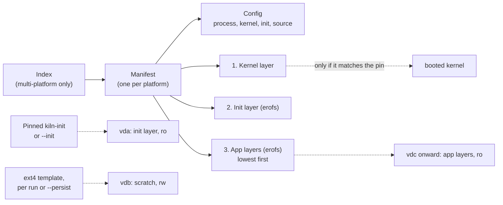

# kiln formats

This document is normative. It defines the **kiln image** (schema versions 1 and 2, provisional until M3 adds kernel and init layers), the **kiln snapshot** (schema version 1) and its lazy index, the **erofs profile** (format version 1), the **guest** that `kiln-init` sets up (devices, init layer, scratch disk, boot sequence) and the **control protocol** (versions 1 to 3) between `kiln-init` and the host.

## kiln image, schema versions 1 and 2

A kiln image is an OCI 1.1 artifact. All JSON kiln writes is serialised with keys sorted and no insignificant whitespace, so identical inputs give identical digests.



Informative: the blobs of a kiln image (solid arrows) and what each becomes when `kiln run` boots it (dotted arrows; see Guest below). The image's own init layer never boots.

### Index (multi-platform images)

An OCI image index (`mediaType` `application/vnd.oci.image.index.v1+json`, `schemaVersion` 2) with `artifactType` `application/vnd.kiln.image.v1`. Each entry in `manifests` is a kiln manifest descriptor with `artifactType` `application/vnd.kiln.image.v1` and a `platform` (`os`, `architecture`, optional `variant`). Entries are sorted by platform (architecture, then os, then variant). A single-platform image is a bare manifest with no index.

### Manifest

An OCI image manifest (`mediaType` `application/vnd.oci.image.manifest.v1+json`, `schemaVersion` 2) with:
- `artifactType`: `application/vnd.kiln.image.v1`. Readers reject manifests without it.
- `config`: a descriptor with `mediaType` `application/vnd.kiln.image.config.v1+json`.
- `layers`, in boot order:
  1. Kernel, `application/vnd.kiln.kernel.v1`: the kernel image itself, the blob kiln pins for the `kernel` the config names. Absent in provisional images, converted while kiln pins no kernel for the architecture (and in images built before M3).
  2. Init layer, `application/vnd.kiln.init.v1.erofs`: the init layer around the `kiln-init` kiln pins (see Init layer below). Absent likewise. `kiln run` never boots it: it boots the init layer of the `kiln-init` it pins itself (or of `--init`), and warns when the image's differs.
  3. App layers, lowest first, `application/vnd.kiln.layer.v1.erofs`: erofs profile images (below), applied as overlayfs lower layers.
- App layer annotations, **informational only** (never used for caching or verification):
  - `dev.kiln.source.digests`: the comma-separated digests of the OCI layers the erofs layer was built from, in order. A squashed bottom layer lists all of them.
  - `dev.kiln.inherits`: `"true"` when the layer has implicit directories whose attributes came from the layers below it. Such a layer is only valid on top of exactly those layers.

### Config

```json
{
  "architecture": "arm64",
  "erofsFormatVersion": 1,
  "process": { "cmd": ["php", "-a"], "entrypoint": ["docker-php-entrypoint"], "env": ["PATH=/usr/local/bin:/usr/bin:/bin"], "stopSignal": "SIGQUIT", "user": "www-data", "workingDir": "/app" },
  "schemaVersion": 1,
  "source": { "manifestDigest": "sha256:…", "reference": "docker.io/library/php:8.4-cli" }
}
```
- `schemaVersion`: 2 when `services` is present, otherwise 1. Readers reject other values, and a config whose version does not match its `services` (version 1 with services, version 2 without).
- `architecture`: `amd64` or `arm64`.
- `process`: copied from the source OCI config. Empty lists and strings are omitted.
- `kernel` (`{ "profile", "version" }`) and `init` (`{ "version" }`): set when the image has that boot layer, omitted otherwise. `kiln run` verifies the kernel layer against the digest kiln pins for `kernel` and the image's architecture (a `custom` profile needs `--allow-custom-kernel`); `init` is informational, since the init layer is always replaced.
- `source.manifestDigest`: the source OCI manifest. `source.reference` is present only for registry inputs. This is unverified provenance.
- `erofsFormatVersion`: the erofs profile version of every app layer.
- `labels`: the source OCI config's labels, `{}` when there are none. Always written by kilns that record labels; a config without it comes from an older kiln, whose labels are unknown.
- `base` (only for images converted with `--base` or made by `kiln rebase`): `{ "name", "manifestDigest", "layers", "sourceLayers" }`. The image's bottom `layers` app layers are exactly the app layers of the kiln manifest `manifestDigest`, the base, and they came from the first `sourceLayers` layers of the source manifest. No squashed layer spans that boundary: layers above it that are merged keep their whiteouts and opaque markers. `name` is informational. `kiln rebase` refuses images without this record.
- `services` (from M3d, omitted when empty): processes `kiln-init` starts before the main process (below). `kiln convert` takes them from the source OCI config's `dev.kiln.services` label, and `kiln rebase` re-derives them from the merged label (spec §16.5).
- There is no kernel command line field and no kiln version field.

The config reader ignores fields it does not know, but a kiln from before M3d accepts only schema version 1: it refuses an image with services instead of running it without them.

### Services

The `dev.kiln.services` label of an OCI image config holds a JSON array; `kiln convert` parses it, checks it and stores the result as the kiln config's `services`, so the image digest covers it. The label stays in `labels` too, as the source's text; `kiln run` reads only `services`. A label that does not parse, has an unknown field anywhere, or breaks a rule below fails the conversion before any layer is converted (`invalid dev.kiln.services label: …`). `kiln rebase` derives the merged config's `services` from the merged `dev.kiln.services` label and sets `schemaVersion` by the rule above, as a rebuild on the new base would; a merged label that does not parse refuses the rebase. Each entry, and each entry of `services`:

```json
{ "name": "php-fpm", "process": { "cmd": ["-F"], "entrypoint": ["php-fpm"], "env": ["A=1"], "user": "root", "workingDir": "/app" }, "ready": "unix:/run/php-fpm.sock", "stopSignal": "SIGQUIT" }
```
- `name`: 1 to 32 of `[a-z0-9-]`, unique in the image. At most 16 services.
- `process`: as the main process's `process` without `stopSignal`: `entrypoint` and `cmd` (together a non-empty argv with a non-empty argv[0]), `env`, `workingDir` (absolute), `user`. Empty lists and unset strings are omitted. The service does not inherit the main process's environment.
- `ready`: `unix:<path>` (an absolute path of at most 107 bytes), `tcp:<port>` (1-65535, digits only) or `none`, the default (omitted).
- `stopSignal`: a signal name or number as for `STOPSIGNAL` (1-31; real-time signals are refused), default SIGTERM (omitted).

`kiln inspect` prints one `service:` line per service: its name, `ready`, stop signal and argv.

### Local store (informative)

```
$KILN_HOME/
  lock                    flock: shared while converting, pulling, pushing, importing or setting up a run; exclusive for gc
  refs.json               name -> digest
  blobs/sha256/<hex>      every blob, content-addressed
  cache/                  layers/, layers-ctx/, squash/, warnings/, init-layers/ (below)
  tmp/                    staging, on the same filesystem as blobs/
  scratch/<run-id>/       a running VM's scratch disk; never touched by gc
```

`$KILN_HOME` (default `~/.local/share/kiln`) holds `blobs/sha256/<hex>`, `refs.json` (`{"refs": {"<name>": "<digest>"}}`), and five caches of small text files. Each entry is written only after the layer it describes has been verified and committed:
- `cache/layers/<source layer digest>@<hex diff_id>@<format version>`: `erofs <digest>` for a layer that depends only on its tar, or `parents <JSON list of hex-encoded implicit paths>`.
- `cache/layers-ctx/<source layer digest>@<hex diff_id>@<format version>@<ctx>`: the erofs digest for a layer with implicit parents. `ctx` is the hex SHA-256 of the JSON list, in implicit-path order, of `[hex(path), null]` (absent in the lowers, or not a directory) or `[hex(path), [mode, uid, gid, mtime_sec, mtime_nsec, [[xattr_index, hex(name), hex(value)], …]]]`.
- `cache/squash/<hex SHA-256 of the newline-joined erofs digests>@<format version>`: a squashed bottom layer. A squash above a recorded base, which keeps overlay markers, prefixes the joined list with the line `upper`.
- GC keeps every kiln image's source manifest and config. For an image with a `base` record it also keeps the source layer blobs from `base.sourceLayers` on (the app half, which `kiln rebase` re-derives) and the base's manifest, walked like any other root.
- `cache/warnings/<layer cache key>`: the JSON list of warnings converting that layer produced, so a cache hit reports them too. Removed by GC together with the `cache/layers/` entry of the same name.
- `cache/init-layers/<kiln-init binary digest>@<format version>`: the digest of the init layer built around that `kiln-init` binary (see Init layer below).

GC keeps every blob reachable from `refs.json`, and also kiln's pinned boot artifacts (the kernel and `kiln-init` blobs its compiled table names) with the init layers built from the pinned `kiln-init` binaries, so runs that need no network keep working after `kiln gc`.

Keying by the verified `diff_id` as well as the compressed digest ties a cache hit to the decompressed content the image config claims, so a blob listed with a different compression or a wrong `diff_id` misses instead of being served another image's filesystem.

`:` in a cache key is written as `_` in its file name.

## kiln snapshot, schema version 1

A kiln snapshot is a VM snapshot (a vmkit bundle, below) as an OCI 1.1 artifact made of fixed-size, content-addressed chunks. JSON is serialised as for images (sorted keys, no insignificant whitespace) and there are no annotations, so the same bundle and chunk size always give the same manifest digest. Refs share `refs.json` with images.

### Manifest

An OCI image manifest (`mediaType` `application/vnd.oci.image.manifest.v1+json`, `schemaVersion` 2) with:
- `artifactType`: `application/vnd.kiln.snapshot.v1`. Readers reject manifests without it, and image readers reject manifests with it.
- `config`: a descriptor with `mediaType` `application/vnd.kiln.snapshot.config.v1+json`.
- `layers`: one descriptor per **distinct** non-zero chunk, `mediaType` `application/vnd.kiln.snapshot.chunk.v1`, in order of first use (files in config order, chunks in offset order). Each chunk is its own blob, so registry and store GC keep exactly the chunks a tagged snapshot references, and identical chunks are shared within a snapshot, across snapshots and in the registry.

### Config

```json
{
  "bundle": { "...": "bundle.json, verbatim as a JSON value" },
  "chunkSize": 1048576,
  "files": [
    { "chunks": ["sha256:…", null, "sha256:…"], "name": "memory", "size": 268435456 }
  ],
  "schemaVersion": 1
}
```
- `schemaVersion`: 1.
- `chunkSize`: a power of two from 65536 (64 KiB) to 16777216 (16 MiB). kiln writes 1 MiB unless told otherwise.
- `bundle`: the bundle's `bundle.json` as a JSON value. Its `version` must be 1.
- `files`: every file of the bundle except `bundle.json`, sorted by name. `chunks[i]` covers bytes `[i·chunkSize, min((i+1)·chunkSize, size))`, so a file has `ceil(size / chunkSize)` chunks and an empty file has none. `null` means the chunk is all zero; zero chunks are never stored. A chunk blob's size is the length it covers, so only a file's last chunk may be short.
- Unknown fields are rejected, at the top level and in `files`.

### Reader's checks

A pulled snapshot is hostile input. Every bound is a typed error that names its limit. A reader, in this order:
1. Verifies the manifest against its digest, requires the media type, `artifactType` and config media type above, and refuses a config descriptor larger than 4 MiB before fetching it.
2. Fetches the config through the store's verified path (digest and size), parses it, and checks:
   - `schemaVersion` is 1 and `bundle.version` is 1;
   - `chunkSize` is in range;
   - at most 64 files, each at most 1 TiB, at most 4 TiB in total;
   - file names match `[a-z0-9][a-z0-9._-]{0,63}`, are not `bundle.json` or `lazy.json`, and are unique, so no file can be written outside the bundle directory;
   - each file has `ceil(size / chunkSize)` chunks;
   - every non-null chunk is a layer whose size is the length the chunk covers;
   - every layer is a chunk, listed once and used by some file.
3. Only then fetches chunks, each verified against its digest and size before it enters the store (an eager pull), or none (a lazy pull).
4. Only then tags the snapshot.

The VMM state files inside a snapshot remain untrusted input to the VMM after these checks. vmkit checks the bundle fully again at restore and runs the VMM in its sandbox; the artifact format does not make the VMM state safe.

### Writing a bundle back

- **Eager pull:** every file is created at its full size and only its non-null chunks are written, so zero chunks stay holes; `bundle.json` (pretty-printed, keys sorted) is written last, so a pull that fails part-way never leaves a directory that looks like a whole bundle.
- **Lazy pull:** only `bundle.json` and the chunk index `lazy.json` are written.

The destination must be missing or an empty directory.

### `lazy.json` (vmkit lazy index format 1)

```json
{"chunk_size":1048576,"files":{"memory":{"chunks":["sha256:…",null],"size":268435456}},"version":1}
```
Canonical JSON with snake_case keys, as in `bundle.json`. `files` maps each file the directory does not hold in full to its size and chunks, with the meaning they have in the config. vmkit serves these files on demand at restore, verifying each chunk; the bounds above apply to it as well, since kiln wrote it from untrusted input.

### The vmkit bundle (informative)

vmkit (bundle format 1) defines the bundle; this summary is informative, and vmkit's own documentation is normative. A bundle directory holds `bundle.json`, the VMM's files (`vmstate` and `memory` for Firecracker; `config.json`, `state.json` and `memory-ranges` for Cloud Hypervisor), and `disk-<n>` for every captured writable disk (sparse). `bundle.json` records `version`, `arch`, `vcpus`, `memory_mib`, `vmm` (`name`, `version`), the `files` and their roles, the `disks` (size, read-only, captured), `net` and `vsock`. Snapshots are not portable across VMMs, VMM versions, architectures or CPU models: vmkit refuses to restore a bundle whose VMM, version or architecture differs from the host's.

When chunking a bundle, kiln opens `bundle.json` (at most 64 KiB) and every file with `O_NOFOLLOW` and requires regular files; anything else in the directory (a subdirectory, a symlink, a FIFO, an invalid name) is an error. The VMM wrote those files and may have planted links to host files, and whatever kiln reads may be pushed.

## erofs profile, version 1

A kiln layer image is a Linux erofs filesystem restricted as follows. Readers reject images that violate the layout rules below (feature flags, data layouts, block size, bounds, ordering).

### Superblock (byte 1024)

| Field | Value |
|---|---|
| `magic` | `0xE0F5E1E2` |
| `checksum`, `feature_compat`, `feature_incompat` | 0 |
| `blkszbits` | 12 (4096-byte blocks) |
| `sb_extslots`, `dirblkbits`, `extra_devices`, compression fields | 0 |
| `root_nid` | 1 |
| `inos` | number of inodes |
| `epoch`, `fixed_nsec` | base time (below) |
| `blocks` | image size / 4096 |
| `meta_blkaddr` | first block of the metadata area |
| `xattr_blkaddr` | first block of the shared xattr table, or 0 if there is none |
| `uuid`, `volume_name` | all zeros |

### Layout

```
block 0               zeros, with the superblock at byte 1024
streamed file data    in tar order
external file data    squash only, in inode order
relocated file data   in inode order (blocks copied to new contiguous FLAT_PLAIN;
                      tail zero-padded; original blocks stay as unused bytes)
directory/symlink     bodies not fully inline, in inode order
xattr table           shared xattr entries, each 4-byte aligned (optional)
metadata area         32-byte slots; slot 0 is zero; inodes from nid 1, in inode order
```

The image ends at a 4096-byte boundary.

### Inodes

- **Numbering:** inodes are numbered breadth-first from the root, visiting directory entries in byte order of their names. A hardlinked inode takes its number at its first occurrence in the breadth-first walk.
- **Data layouts:** only `FLAT_PLAIN` (0) and `FLAT_INLINE` (2). `i_format` bit 4 is never set.
- **Inline tails:** a tail is inline only when it fits after the inode and its xattrs within one block.
  - For regular files, that is decided while streaming, assuming the worst case (a 64-byte inode and all xattrs inline): `tail + 64 + X ≤ 4096`, where X = 0 for a file without xattrs, and otherwise X = `12 + Σ entry sizes` with entry size = round_up(4 + name_len + value_len, 4). Thus a file with no xattrs can inline a tail of up to 4032 bytes.
  - For directories and symlinks, it is decided exactly.
- **Compact vs extended:** a 32-byte compact inode is used only when all of these hold. Otherwise the inode is 64-byte extended.
  - uid ≤ 65535 and gid ≤ 65535
  - nlink ≤ 65535
  - size < 2³²
  - mtime equals the base time, including nanoseconds

  A compact inode's `i_mtime` is 0.
- **Base time:** the minimum `(sec, nsec)` mtime of the layer's explicit directory, file, symlink, device, FIFO, whiteout and hardlink entries (opaque markers excluded). It is 0 for an empty layer. For squashed images, it is the minimum over all inodes.
- **Inode records:** a record never crosses a block boundary. When it would, it moves to the next block.
- **`i_ino`:** the 1-based inode number.

### Directories

- Every directory contains `.` and `..`. The root's `..` is the root.
- Entries are sorted in strict byte order, including `.` and `..`, and packed greedily into 4096-byte blocks of dirents followed by names. Non-last blocks are zero-padded. Readers reject entries that are not in strict byte order.
- `nlink` is 2 plus the number of subdirectories.

### Xattrs

- **Name indexes:** `user.` 1, `system.posix_acl_access` 2, `system.posix_acl_default` 3, `trusted.` 4, `security.` 6. Other namespaces are dropped with a warning, and so are `trusted.overlay.*` xattrs supplied by the tar.
- **Shared table:** an `(index, name, value)` triple goes into the shared table when two or more inodes carry it, or when an inode's all-inline body would exceed 4032 bytes (in which case all of that inode's xattrs are shared).
  - Shared entries are ordered by first use in inode order.
  - Within an inode, shared ids come first, then inline entries, each sorted by `(index, name)`.
- `h_name_filter` is 0.

### Overlay markers

- A whiteout is a character device 0:0, mode 0, uid and gid 0.
- An opaque directory carries `trusted.overlay.opaque = "y"`. Only `.wh.` entries produce markers: `trusted.overlay.*` xattrs supplied by the tar are dropped.
- When merging (parent inheritance and squash), a directory is opaque only when `trusted.overlay.opaque` is exactly `"y"`, and a root-level opaque marker has no effect on the merged view, as in overlayfs.
- Squashed bottom layers contain no markers. A squash of app layers above a recorded base keeps whiteouts and opaque markers, and marks opaque any directory that replaces a lower non-directory or whiteout.

### Layer semantics (applying one tar)

- **Directory over directory:** merge. The header's mode, uid, gid and mtime replace the old ones; header xattrs are added over the existing ones; children are kept.
- **Other replacements:** anything else at an existing name replaces it, along with its subtree.
- **Symlinks:** permission bits are always 0777.
- **Hardlinks:**
  - A hardlink names the inode at its target path when the link entry is read.
  - The link header's mode (except for symlinks), uid, gid, mtime and xattrs are applied to that inode.
  - It is an error if the target is missing, is a directory, is a whiteout, is the link itself, or lies inside the entry the link replaces.
- **Whiteouts:**
  - `.wh.<name>` hides `<name>` in lower layers.
  - It is an error if `<name>` already exists in the same layer. A later entry with that name replaces the whiteout.
  - `.wh..wh..opq` marks its directory opaque. On the layer root, the marker is recorded but has no effect on the merged view (overlayfs ignores it).
- **PAX records:** an empty `path`, `linkpath`, `uid`, `gid`, `size` or `mtime` value means the record is absent; the ustar header value is kept.
- **Unsupported entries** are errors:
  - Sparse entries.
  - Tar entry types other than regular file, directory, symlink, hardlink, character and block device and FIFO.
  - A PAX size that differs from the header size.
  - Devices with major > 4095 or minor > 1048575.
  - A uid or gid above 32 bits.
  - An empty symlink target.
  - Header-only entries (hardlink, symlink, directory, device, FIFO, V7 trailing-slash directory) whose tar header size is nonzero.
  - A global PAX (`g`) header carrying any key kiln acts on (path, linkpath, uid, gid, size, mtime, `SCHILY.xattr.*`, `GNU.sparse.*`, `LIBARCHIVE.xattr.*`).
  - More than one pending header of the same type (x, L or K) before one entry.
  - An entry with both a GNU long name (L) and a PAX `path`, or both a GNU long link (K) and a PAX `linkpath`.
  - An xattr name longer than 255 bytes (after its namespace prefix) or a value larger than 65535 bytes.
  - An inode that needs more than 255 shared xattrs.
  - More entries than the entries-per-layer limit, counting both tar headers and every entry the layer creates, implicit directories included.
- **Warnings** (conversion continues):
  - Xattrs outside the five namespaces above are dropped with a warning.
  - `trusted.overlay.*` xattrs supplied by the tar are dropped with a warning.
  - `LIBARCHIVE.xattr.*` records are dropped with a warning.
  - Conversion warnings are capped at 100, followed by one "N more warnings suppressed" line.

### Implicit directories

A directory created because a descendant, whiteout or opaque marker needed it inherits from the same path in the overlay of the lower layers, with `trusted.overlay.*` keys stripped. That means the topmost lower layer providing the path, where whiteouts, opaque directories and non-directories in nearer layers hide farther ones. A directory is opaque only when `trusted.overlay.opaque` is exactly `"y"`, and a root-level opaque marker hides nothing (as in overlayfs).
- **Not described in this layer:** it takes mode, uid, gid, mtime and xattrs from that lower directory. If the path is absent there, or is not a directory, it takes mode 0755, uid 0, gid 0 and mtime = base time.
- **Described later by its own header:** it keeps the header's mode, uid, gid and mtime, and the inherited xattrs lie under its own.
- **Root:** an implicit root always takes the defaults.

### Known divergences from containerd's applier

kiln is checked against containerd's overlayfs snapshotter (kiln-erofs Task 14). It deliberately differs in these cases, which image builders do not produce:
1. containerd sets directory mtimes in a final pass. If a later entry in the same layer replaced a directory, or one of its parents, with a non-directory, that pass fails or re-times the replacement. kiln keeps each entry's own attributes.
2. containerd resolves an implicit directory's attributes by searching each lower layer on its own. It skips non-directories, ignores whiteouts and opaque directories, and fails on a file in the middle of the path. kiln uses the overlay view.
3. containerd follows symlinks in lower layers while resolving parents. kiln does not.
4. A tar may carry `trusted.overlay.*` xattrs in PAX records. containerd writes them to disk, where they can forge whiteouts, opaque directories or redirects. kiln drops them with a warning; overlay markers come only from `.wh.` entries.
5. containerd ignores everything after a tar's end-of-archive marker. kiln requires the decompressed remainder to be zero padding and rejects the layer otherwise, so the bytes covered by `diff_id` mean one thing.
6. A tar header whose size field holds only NULs and spaces: Go's `archive/tar` reads it as 0; kiln rejects the layer (the `tar` crate parses sizes itself).

Other header numeric fields (mode, uid, gid, mtime, device numbers) that hold only NULs and spaces read as 0, as in Go's `archive/tar`.

### Determinism

Output depends only on the tar content, the resolved inherited attributes and the format version. Any change to output bytes requires a new format version; golden digests for each version are immutable.

## Guest

### Devices

The VM's block devices, in this order (Linux names them `vda`, `vdb`, …):
1. `vda`, read-only: the init layer.
2. `vdb`, read-write: the scratch disk.
3. `vdc` onward, read-only: the app layers, lowest first. `vdz` is followed by `vdaa`.

vsock gives the guest CID 3. The kernel command line is `root=/dev/vda ro rootfstype=erofs init=/kiln-init panic=-1 quiet loglevel=3`, followed by the VMM's console and backend parameters.

### Init layer

An erofs profile image of exactly these entries, each owned by 0:0 with mtime 0: the directories `/`, `/dev`, `/kiln`, `/proc` and `/sys` (mode 0755) and the static `kiln-init` binary at `/kiln-init` (mode 0755). The same binary always gives the same bytes.

### Scratch disk

The scratch disk starts as the ext4 template `crates/kiln-image/assets/ext4-template.img.zst` (zstd; SHA-256 `29a11ac3061b3adc119b95917100e702130eb6cc1f686981bb84f70da1370e1d`), which `assets/make-ext4-template.sh` regenerates byte for byte:
- 64 MiB, made with `mke2fs -t ext4 -b 4096 -I 256 -i 65536 -O meta_bg,^resize_inode -U 6b696c6e-7363-7261-7463-680000000001 -E hash_seed=6b696c6e-6861-7368-7365-656400000001,lazy_itable_init=1,lazy_journal_init=0,nodiscard,root_owner=0:0` from e2fsprogs 1.47.2-3+b12, with `E2FSPROGS_FAKE_TIME=1`;
- the superblock's `s_flags` set to 2 (unsigned directory hashes), which `mke2fs` would otherwise take from the build machine's `char` signedness.

The host decompresses the template into a sparse file (blocks of zeros stay holes) and extends it to the run's size, a multiple of 4096 of at least 64 MiB. The guest grows the filesystem to exactly that size.

Growing online to 64 GiB works on Firecracker. On Cloud Hypervisor 53 the resize hangs beyond roughly 8 GiB: Cloud Hypervisor offers WRITE_ZEROES on the disk, the kernel then zeroes the new inode tables through it, and that never completes. 8 GiB and kiln's default of 4 GiB are expected to work without nesting; this is unverified on bare metal. Under nested virtualization (Lima on Apple Silicon) Cloud Hypervisor 53 growth is unreliable at smaller sizes too. Cloud Hypervisor 53 guests under nested virtualization also sometimes stall, more often in vsock-heavy cases (stdio streaming, protocol abuse). Firecracker is the reference VMM.

### Differences from Docker

`kiln-init` sets the guest up much as Docker sets up a container, with these deliberate differences:
- **PID 1:** init is PID 1, as with `docker run --init`; the main process is not. An app without a SIGTERM handler therefore exits on `Shutdown` at once, with 143, where under Docker it would be ignored as PID 1 and killed after the grace period with 137.
- **`/sys` and cgroup2** are mounted read-write (`nosuid,nodev,noexec`); Docker mounts them read-only.
- **`/dev/shm`** is a tmpfs with `nosuid,nodev` and mode 1777, without `noexec` and without Docker's `size=64m`, so its size is the tmpfs default of half the guest's RAM.
- **`/dev`** is the kernel's full devtmpfs, not Docker's minimal tmpfs, so every device the guest kernel has is visible.
- **`/dev/console`** is the VM's serial console; what is written to it lands in the VM's `console.log`.

### Boot sequence

`kiln-init` runs as PID 1 through seven stages:

| Stage | Name | What it does |
|---|---|---|
| 1 | early | Mounts `proc` and `sysfs` (`nosuid,nodev,noexec`), and `devtmpfs` unless the kernel mounted it; `reboot(CAD_OFF)`, so Ctrl-Alt-Del becomes SIGINT to init. |
| 2 | control | Connects vsock port 1024, sends `Hello`, receives `Config`. |
| 3 | storage | A tmpfs at `/kiln`; app layer `n` mounted read-only (erofs) at `/kiln/layers/<n>`; the scratch disk mounted at `/kiln/rw` with `noinit_itable` and grown online with `EXT4_IOC_RESIZE_FS` (it fails if `vdb` is smaller than `Config.scratch.sizeBytes`); `upper/` and `work/` created on it; the overlay mounted at `/kiln/root` with one mount(2) call and the data `lowerdir=<top…bottom>,upperdir=/kiln/rw/upper,workdir=/kiln/rw/work,xino=on,redirect_dir=off,index=off,metacopy=off`. Without layers, the only lower directory is the empty `/kiln/empty`. |
| 4 | root | Refuses an image whose `/proc`, `/sys`, `/dev` or `/etc` exists as a symlink or another non-directory (runc refuses such a `/proc` and `/sys`; for `/dev` and `/etc` it is kiln's own rule, where runc resolves the symlink inside the rootfs); creates missing `/etc`, `/proc`, `/sys`, `/dev` in the overlay (they land in the upper layer); mounts `proc`, `sysfs`, `cgroup2` on `/sys/fs/cgroup` and `mqueue` on `/dev/mqueue` (each `nosuid,nodev,noexec`), `devtmpfs` (`nosuid`), `devpts` (`nosuid,noexec`, `newinstance,ptmxmode=0666,mode=0620,gid=5`) and a tmpfs on `/dev/shm` (`nosuid,nodev`, mode 1777); replaces `/dev/fd`, `/dev/stdin`, `/dev/stdout`, `/dev/stderr` and `/dev/ptmx` with symlinks to `/proc/self/fd`, `/proc/self/fd/0`, `/proc/self/fd/1`, `/proc/self/fd/2` and `pts/ptmx`; `pivot_root(".", ".")` and detaches the old root. Nothing is mounted on `/run` or `/tmp`. |
| 5 | identity | Sets the hostname; writes `/etc/hostname`, `/etc/hosts` and `/etc/resolv.conf` as new regular files (mode 0644, after unlinking whatever was there, so a symlink is replaced, never followed); brings up `lo`, and with `Config.network` brings up `eth0`, adds its address and a default route over rtnetlink (on-link when the gateway is outside the address's prefix, as for a CNI's `/32` pod address), and with `Config.network.ipv6` its IPv6 address (without duplicate address detection, so it is usable at once) and IPv6 default route. A kernel without IPv6 fails this stage. |
| 6 | process | Starts the services, each ready before the next, then the main process (below), and sends `Running`. |
| 7 | supervise | Reaps every process and handles host messages and signals until the run ends (below). |

`/etc/hosts` has Docker's layout: `127.0.0.1 localhost`, the IPv6 loopback and multicast names, then the guest's address (or `127.0.1.1` without a network) with the hostname, and with IPv6 the guest's IPv6 address with the hostname. `/etc/resolv.conf` lists `Config.network.dns` as `nameserver` lines, then `Config.network.search` as one `search` line and `Config.network.options` as one `options` line when they are set. Without a network it holds the comment `# kiln: this VM has no network`, and with a network but no DNS servers the comment `# kiln: no DNS servers configured`; either is followed by `nameserver 127.0.0.1`, as Docker's `--network none` still lists a resolver, so that lookups fail at once (nothing answers there) instead of tools that need a resolver refusing to start.

**The main process** (stage 6):
- **User:** `Config.process.user` is `user`, `uid`, `user:group` or `uid:gid`, resolved with runc's rules against the image's `/etc/passwd` and `/etc/group` (missing files read as empty; lines are trimmed; trailing fields may be missing, so `app:x:1000` is a group without members and a passwd line needs only its name, password, uid and gid; lines without those are skipped, as are malformed lines whose uid or gid is not a number or is out of range). A name must exist; a number need not. A matched user gets its passwd gid and home. An explicit group (a name that must exist, or any number) replaces the gid; without one, a user matched by passwd also gets every group that lists it as a member. The process's groups are the gid followed by those, without duplicates. No user means root.
- **Environment:** `Config.process.env` as given, later entries replacing earlier ones with the same key, then `PATH=/usr/local/sbin:/usr/local/bin:/usr/sbin:/usr/bin:/sbin:/bin`, `HOSTNAME=<hostname>`, `HOME=<passwd home, else />` and, in tty mode, `TERM=xterm`, each only when not already set.
- **Working directory:** `Config.process.workingDir`, default `/`, created (mode 0755, owned by root) when missing.
- **Stdio:** without `tty`, pipes relayed to vsock ports 1025–1027 (stdin is `/dev/null` and port 1025 is not connected unless `interactive`). With `tty`, a pseudo-terminal from the guest's devpts, set to the given size and relayed to port 1028; the process gets it as its controlling terminal.
- The process runs in a new session. Then groups, gid and uid are set (all three real, effective and saved IDs), and argv (`entrypoint` followed by `cmd`) is executed, searching the environment's `PATH` when argv[0] has no `/`.

**Services** (stage 6, protocol version 2): before the main process, each of `Config.services` is started in order:
- Its user, groups, environment and working directory follow the main process's rules above, from its own `process` (without `TERM`). Its stdin is `/dev/null`. Without `tty` it runs in a new session; with `tty` it runs in its own process group of init's session and is never a session leader, so it can never take the pseudo-terminal as its controlling terminal.
- It shares the main process's stdout and stderr. Without `tty` these are the same pipes (relayed to ports 1026 and 1027). The pipes are owned by the main process's user; when a service runs as another uid they are made writable by everyone (mode 0622), so that it too can reopen `/dev/stdout`.
- With `tty`, a service's stdout and stderr are a write-only handle (`O_WRONLY|O_NOCTTY`) on the pseudo-terminal, never the read-write slave the main process has. So a service cannot read the terminal's input, and, since it is not a session leader, cannot take the terminal. The 0622 mode applies to pipes only: a service running as another uid cannot reopen `/dev/stdout` under `-t`. A service running as root or as the main process's uid can still reopen the pseudo-terminal by its path, read its input or change its termios. It is in the main process's trust domain (it could equally ptrace the main process), so this is an accepted residual; a separate terminal or an output relay for services is the later option.
- It is ready when a connection to its Unix stream socket, or to `127.0.0.1:<port>`, is accepted (init connects and closes at once, retrying every 5 to 50 ms), or at once with `none`. The next service, or the main process, starts only then. A `tcp:` service must listen on the loopback address or the wildcard address (`0.0.0.0`); one listening only on `::1` or on the network's address is never ready. The probes are real connections, closed without a byte sent, and may show up in the service's log.
- `Config.readyTimeoutMs`, counted from `Config`'s arrival, bounds every service's readiness (including what stage 3 took). A service not ready by then, any process exiting while a service is starting, or a service that cannot be started fails stage 6 with a message naming the service; an exec failure keeps its errno, as the main process's does. A service that exits after the last readiness check ends the run, as in stage 7.

**Supervision** (stage 7):
- `Signal { sig }` is sent to the main process. `WindowSize` resizes the pseudo-terminal (ignored without `tty`).
- The run ends with the first of its processes (services and the main process) to exit, or with `Shutdown { graceSecs }`, or SIGINT or SIGTERM to init (with `Config.shutdownGraceSecs`). The processes still running are then stopped one at a time in reverse start order, so the main process first: each gets its stop signal (the main process `stopSignal`, a service its own). The grace period (`graceSecs`, or `Config.shutdownGraceSecs` when a process's exit ended the run) is split evenly between the processes still to stop: when one is sent its stop signal, its share is what remains of the grace period divided by the number of processes still running that have not yet been sent theirs, itself included. The next one gets its stop signal once that one has exited, or, if it has not exited when its share ends, once it has been sent SIGKILL. So a process that ignores its stop signal costs the ones after it only its share, never their stop signals. When the grace period ends, every process but init gets SIGKILL. A later request can shorten the deadline, never extend it. Without services this is: `stopSignal` to the main process once, and SIGKILL to everything at the deadline. Execs (protocol version 1) never end the run and are not stopped in turn: they are killed with everything else once the processes above have exited.
- When every one of them has exited, every other process gets SIGKILL and is reaped; then stdout and stderr (or the terminal) are relayed to EOF; then the scratch filesystem is synced and, on a best-effort basis, made read-only (EBUSY is ignored); then `Exited` is sent, with the status of the process whose exit ended the run (and its name in `service` when it was a service), or after a shutdown request the main process's; init ends the VM with `Config.exitMethod`. `Exited` therefore means the scratch disk is safe: the host never kills the VM on `Exited` itself, but a VM killed after it keeps every write (`--persist` relies on this). `InitFailed` paths do not sync first.
- The host's bounds around this (kiln): after `Shutdown` it kills the VM when the guest's final message has not come within the grace period plus the end bound (10 s, 60 s with `--persist`), the time init has for the sync; after `Exited`, `InitFailed` or the control connection closing, the VM has the end bound to end. Without a stop request no bound applies between `Running` and the final message: a guest stuck before `Exited` (in the sync, say) is like a main process that still runs, and the host waits, as `docker run` does; the user's second SIGINT kills it. A stop request before `Running` is acted on only when stage 6 completes (every service ready), so until then the stop bound counts from the boot deadline, not from the request; it is never shorter than the grace period plus the end bound from the request.

**Failure:** a failing stage prints `kiln-init: <stage name>: <error>` on the console, sends `InitFailed` when the control connection is up, sends SIGKILL to every other process, and ends the VM with `Config.exitMethod`, or with a reboot before `Config` arrived. A panic does the same. A protocol error from the host, a second `Config`, or the host closing the control connection, is a failure too: it is detected by a reader thread once `Config` has arrived and acted on when init enters its next stage (and at the end of stage 6, before `Running`), or at once during stage 7; the failure names it rather than a send that failed because of it.

## Control protocol

This section defines versions 1 to 3. Version 2 adds `Config.services`, `Config.readyTimeoutMs` and `Exited.service`, and widens `Config.shutdownGraceSecs` to the stop that follows a process's exit, and nothing else; version 3 adds build mode (`Config.mode`, `Config.disks`, `Config.sourceDateEpoch`, `RunStep`, `Finish`, `StepExited`, `StepSealed`, below) and nothing else; a version adds message types, optional fields and values, and never changes what an earlier version defines (spec §9.8).

Version 1 was frozen at the first `kiln-init` release. It includes what the kiln-shim exec and volumes work added before any release (spec §9.8): the exec message types 10 to 16, vsock port 1029, `Config.volumes` and `Config.podDisk`, and `Config.network.search`, `options` and `ipv6`. Those are specified for now by `docs/superpowers/specs/2026-10-30-kiln-shim-exec-volumes-design.md` (and the IPv6 design, `docs/superpowers/specs/2026-10-21-guest-ipv6.md`), not in the tables below.

### Transport

The guest connects to the host (vsock CID 2) on these ports, and only the guest connects. With vmkit, the host listens on the Unix socket `<vm.vsock_socket()>_<port>` for each port it serves, bound before the VM starts.

| Port | Stream | Direction | Connected |
|---|---|---|---|
| 1024 | control (framed, below) | both | stage 2, once |
| 1025 | stdin, raw bytes | host → guest | stage 6, only with `interactive` and without `tty` |
| 1026 | stdout, raw bytes | guest → host | stage 6, without `tty` |
| 1027 | stderr, raw bytes | guest → host | stage 6, without `tty` |
| 1028 | terminal, raw bytes | both | stage 6, only with `tty` |

On the raw streams EOF is a half-close: the host shuts down its writing side of 1025 when stdin ends, and the guest shuts down its writing side of 1026, 1027 or 1028 when the process's output ends. The bytes are not interpreted.

### Framing

A frame is a `u32` little-endian length, then a `u8` message type, then the payload. The length counts the type byte and the payload: at least 1 and at most 65536. The payload is exactly one JSON object: its first byte is `{` and its last `}`, with no whitespace or data around it. Unknown fields, duplicate keys, wrong types and out-of-range values are errors, as are an unknown type, a type sent in the wrong direction, a length of 0 or over 65536 (rejected before the rest is read) and EOF inside a frame. EOF before a frame's first byte closes the connection cleanly. Both sides validate a message before sending it.

### Messages

| Type | Name | Direction | Payload |
|---|---|---|---|
| 1 | `Hello` | guest → host | `{"protocol": 3}`: the highest protocol version the guest implements, at least 1. |
| 2 | `Config` | host → guest | The run's configuration (below). |
| 3 | `Stage` | guest → host | `{"n": 3}`: init entered stage `n` (1–7). Sent for stages 3 to 7; stages 1 and 2 precede it. |
| 4 | `Running` | guest → host | `{}`: the main process started (after every service was ready). |
| 5 | `Exited` | guest → host | `{"signaled": false, "code": 0}`: the run ended, its output reached EOF, and the scratch disk was synced and remounted read-only (best effort). `code` is the exit status (0–255), or with `signaled` the signal that killed it (1–64), of the main process, or (version 2) of the service named in the optional `service` (`[a-z0-9-]{1,32}`), whose exit ended the run. |
| 6 | `InitFailed` | guest → host | `{"stage": 6, "errno": 2, "message": "…"}`: init failed at `stage` (1–7). `errno` (1–4095) is present at stage 6 only when executing the entrypoint (the main process's, or a service's) failed; it may be present at other stages. `message` has at most 4096 bytes and is untrusted text. |
| 7 | `Shutdown` | host → guest | `{"graceSecs": 10}`. |
| 8 | `Signal` | host → guest | `{"sig": 1}`: a signal number from 1 to 31. |
| 9 | `WindowSize` | host → guest | `{"rows": 24, "cols": 80}` (each 0–65535). |
| 17 | `RunStep` | host → guest | Version 3, build mode: run one step (below). |
| 18 | `Finish` | host → guest | Version 3, build mode: `{}`; the build is over, sync and end the VM. |
| 19 | `StepExited` | guest → host | Version 3, build mode: `{"id": 1, "code": 0}` or `{"id": 1, "signal": 9}`: the step's command ended (exactly one of `code` 0–255 and `signal` 1–64) and its output reached EOF. |
| 20 | `StepSealed` | guest → host | Version 3, build mode: `{"id": 1, "offset": 0, "len": 8192, "sha256": "<64 lowercase hex>", "entries": 5}` (below). |

Types 10 to 16 are version 1's exec and file messages (above). Build mode's types follow them.

`Config` (camelCase keys; optional fields are omitted when unset, and a reader also accepts `null` for them):

| Field | Type | Rules |
|---|---|---|
| `process.entrypoint`, `process.cmd` | lists of strings (default empty) | Together the argv; it must be non-empty, with a non-empty argv[0]. |
| `process.env` | list of `KEY=value` (default empty) | `KEY` (the text before the first `=`) non-empty and without control characters; the value may be empty. The final environment: the host has already merged the image's env and overrides. |
| `process.workingDir` | string, optional | Absolute. |
| `process.user` | string, optional | `user` or `user:group`, both parts non-empty, without control characters (newline included). |
| `stopSignal` | integer | 1–31. |
| `tty` | `{rows, cols}`, optional | Run on a pseudo-terminal of this initial size. |
| `interactive` | boolean | Relay stdin. |
| `hostname` | string | 1–64 characters of `[A-Za-z0-9.-]`, the first alphanumeric. |
| `network` | object, optional | `eth0`: `address` and `gateway` (dotted IPv4) with `prefixLen` 8–32. The address is not the gateway, and on prefixes up to /30 neither is the subnet's first or last address; a gateway outside the prefix is routed to on-link. `dns`: at most 3 IPv4 addresses (they also answer AAAA queries; DNS has no IPv6 transport). `search` (optional, omitted when empty): at most 6 domains of 1–253 printable non-space bytes. `options` (optional, omitted when empty): resolver options of 1–64 printable non-space bytes, e.g. `ndots:5`. |
| `network.ipv6` | object, optional | `eth0`'s IPv6 side: `address` and `gateway` in the same `/prefixLen` (64–126), different, neither the prefix's first address, and both unicast beyond the link (not unspecified, loopback, IPv4-mapped, link-local or multicast). |
| `layers` | integer | The number of app layers, 0–128. |
| `scratch.sizeBytes` | integer | A multiple of 4096, at least 67108864. |
| `exitMethod` | `"reboot"` or `"poweroff"` | How the guest ends the VM (vmkit's `guest_exit` capability). |
| `shutdownGraceSecs` | integer | The grace period for SIGINT or SIGTERM to init, and (version 2) for stopping the other processes when one exits. |
| `services` | list, optional (version 2) | The services, as in the kiln config (above) with these differences: `process.env` is the final environment (the service's own `process.env` from the kiln config, not the image's main env, then the run's overrides, which the host adds to every service); `ready` is always present; `stopSignal` is an integer 1–31. At most 16, unique names. Omitted when empty, so a `Config` without services is a version 1 `Config`. |
| `readyTimeoutMs` | integer, optional (version 2) | 1–4294967295; present exactly when `services` is. How long, from `Config`'s arrival, the guest allows for every service to be ready. The host sets it when it sends `Config`, to at most what remains of its boot timeout less 2 seconds (the boot deadline is taken just before the VM starts, so it can be shorter by the VM's start time; it is 1 at the least), so that the guest reports a service that is never ready (`InitFailed`) before the host's boot timeout ends the VM. |

No string may contain a NUL byte.

The whole `Config` is one frame, and a frame is at most 65536 bytes including the type byte, so the JSON payload (argv, environment, hostname and every other field, with JSON escaping) must fit in 65535 bytes. Docker allows about 2 MiB for argv and environment (ARG_MAX). The host builds the `Config` before it boots the VM and refuses a larger one there, with an error that names the sizes of the command line and the environment; no VM is started.

### Session

1. The guest connects port 1024 and sends `Hello`. The host answers the first `Hello` with `Config`, once per VM.
   - **Versions.** A host supports every version from 1 to its own (3). A `Hello` naming a higher version is a violation, so a version 1 host refuses a version 2 `kiln-init`; that is by design, since `kiln run` is to boot the `kiln-init` pinned to it (spec §8.1), the two shipping together. Until kiln pins a released `kiln-init`, every run names one with `--init`, so mixed versions are expected, and this gate handles them. The host sends only what the guest's version defines for services: when the run has services (they need version 2) and the guest speaks version 1, or the VM is a build VM (version 3) and the guest speaks an earlier version, the host sends no `Config`, kills the VM and reports 125 with an error naming the version required. The exec and volume additions of version 1 are not gated on the guest's version. A guest may use only what its version defines: `Exited.service` from a version 1 guest, or naming a service the run does not have, is a violation. The guest decodes strictly, so a version 1 `kiln-init` refuses a version 2 field (`InitFailed` at stage 2).
   - **kiln-shim** sends no services in M3d: it cannot see the image's `dev.kiln.services` label (it never reaches the OCI runtime spec), so under it an image with services runs without them. This is a known gap; the M4 follow-up has the shim read the image config through containerd's image service and either pass the services or refuse.
2. The guest sends `Stage` for stages 3 to 7, `Running` once the main process has started, then `Exited`, or `InitFailed` at any point. The host sends `Shutdown`, `Signal` and `WindowSize` at any time after `Config`.

The host checks the order of the guest's messages: `Stage` numbers strictly increase (gaps allowed) and only stages 3 to 6 come before `Running`; `Running` comes once, at stage 6; `Stage 7` comes only after `Running`; `Exited` only at stage 7; `InitFailed` once, anywhere after `Hello`, naming a stage no earlier than the last one reported (`Running` counts as stage 7). Nothing may follow `Exited`; anything after `InitFailed` is ignored, so the failure is what is reported.

The host kills the VM, and reports 125, on any violation: a message out of that order, a second connection to port 1024 (or to any port it serves), a second `Hello` (a reset guest starting over), any message before `Hello`, a protocol version it does not support, or any framing or payload error. The guest treats a framing or payload error, a second `Config`, or the host closing port 1024 as a failure (InitFailed, then the VM ends).

### Build mode (version 3)

`Config.mode` is `"run"` (the default, omitted) or `"build"`. In build mode `process` is empty, `tty`, `interactive`, `services`, `readyTimeoutMs`, `volumes` and `podDisk` are unset (a build VM has no services and no kiln-shim pod fields), and the guest runs the host's steps instead of a main process. A host sends a build-mode `Config` only to a guest whose `Hello` names version 3 or later: against an older guest it sends no `Config`, kills the VM, and the build VM fails to start with an error naming the version required. A version 1 or 2 guest would refuse the fields anyway (strict decoding). kiln-shim never sends a build-mode `Config`; a build-mode guest treats `ExecStart`, `ExecSignal`, `ExecWindowSize` and `FileUpdate` as violations.

**Disks**, in order, nothing hot-plugged: `vda` init layer, `vdb` scratch, `vdc` the **output disk** (raw, created and sized by the host's caller, a multiple of 4096 bytes), then `Config.layers` base layers (erofs, bottom first: the boot root), then `Config.disks`, a list of `{"kind": "erofs"|"ext4", "readOnly": bool}`, one per further disk in order. `erofs` disks are layers a step stacks (`lowersAdded`), `ext4` disks are cache disks a step mounts. `layers` plus the entries of `disks` are at most 128. Disk indexes count from `vda` = 0. The host's caller budgets disks against the VMM's devices: the fixed ones are the init layer, scratch, the output disk and vsock, plus a NIC when the VM has a network.

**`Config` fields** (version 3, build mode only; refused in run mode):

| Field | Type | Rules |
|---|---|---|
| `mode` | `"run"` or `"build"`, optional | Omitted when `"run"`. |
| `disks` | list, optional | As above. Omitted when empty. |
| `sourceDateEpoch` | integer, optional | Seconds since the epoch. When present, every entry of every sealed diff has an mtime of at most this value, copied-up parent directories included; when absent the guest's times are kept. |

**`RunStep`** (camelCase):

| Field | Type | Rules |
|---|---|---|
| `id` | integer | The step's id (u32); the guest's answers carry it. |
| `command` | `{"argv": [..]}` or `{"shell": ".."}` | A non-empty argv with a non-empty argv[0], or a script run as `/bin/sh -c <script>`. |
| `env` | list of `KEY=value` | As `process.env`; the guest adds `PATH`, `HOSTNAME` and `HOME` (`/root` for uid 0, else `/`) when unset. |
| `workdir` | string | Absolute; created as root when missing (that is part of the step's diff), then entered. |
| `uid`, `gid` | integers | Not 4294967295. The step runs as `uid:gid` with `gid` as its only group. |
| `lowersAdded` | list of disk indexes, optional | `erofs` entries of `Config.disks`, each at most once per VM: stacked on the root before the step, bottom first. |
| `mounts` | list of `{"disk", "target", "readOnly"}`, optional | `ext4` entries of `Config.disks` mounted at `target` for the step (read-only if the disk is). At most 64. |
| `secrets` | list of `{"target", "data"}`, optional | `data` is standard base64 (padded, strict). The file appears at `target`, mode 0400, owned by `uid:gid`, on a tmpfs: never in the upper or the output. At most 64. |
| `egress` | boolean | Whether the step may reach the network. The host enforces it in the VM's network namespace; the guest does not act on it. |
| `timeoutMs` | integer | At least 1. The host's deadline for the step and its seal; the guest does not act on it. |

Targets are absolute, not `/`, without `.`, `..` or empty (`//`) components (one trailing `/` is allowed and ignored), and unique across `mounts` and `secrets`. Secrets travel inline: the whole `RunStep` is one frame, so a step's secrets are at most about 44 KiB together, and the host refuses a larger step before sending it.

**Lower layers.** A step's overlay has as lower directories the base layers, the layers stacked so far and one sealed upper per successful step, at most 230 (`MAX_BUILD_LOWERS`): the guest names them all in one mount(2) data page. The host refuses a `RunStep` that would mount more with its own error, before sending anything, so the VM stays usable; its caller squashes layers or boots a new VM. The guest treats such a step as a violation.

**A step**, in the guest:
- A fresh overlay (`nodev`) is mounted with every lower so far, the newest on top, and a new upper and work directory on scratch.
- Mounted in it, with every path resolved inside the root (`RESOLVE_IN_ROOT`, so the image's symlinks cannot lead a mount out of it): `/proc` (a clone of init's, with `/proc/sys`, `/proc/sysrq-trigger`, `/proc/irq`, `/proc/bus` and `/proc/fs` bound read-only, and `/proc/kcore`, `/proc/keys`, `/proc/timer_list`, `/proc/sched_debug`, `/proc/acpi`, `/proc/scsi`, `/proc/latency_stats` and `/proc/timer_stats` masked where present (the `/proc` entries of runc's `readonlyPaths` and `maskedPaths`, except `/proc/asound`): `/dev/null` over a file, an empty read-only tmpfs over a directory); a read-only `sysfs` on `/sys`; a minimal **`/dev`** (a read-only tmpfs holding only the character devices `null`, `zero`, `full`, `random`, `urandom` and `tty`, the links `ptmx` → `pts/ptmx`, `fd`, `stdin`, `stdout` and `stderr`, a `devpts` on `/dev/pts` and a tmpfs on `/dev/shm`): no block device, so neither the output disk nor a layer disk; the cache disks (`nodev`); `/etc/hostname`, `/etc/hosts` and `/etc/resolv.conf`, each only where the image has a regular file or nothing, never through a symlink; and the secrets (`nodev`).
- Mount points that had to be created are removed after the step, so none reaches the diff. A parent directory that overlayfs copied up to create one stays in the diff (`/root` for a cache disk at `/root/.cache`), as BuildKit's do.
- The guest connects ports 1026 and 1027 anew for each step: they carry the step's stdout and stderr, and their EOF ends its output. A connection while no step runs, or a second one in a step, is a violation.
- The command runs in a mount namespace of its own, pivoted into the overlay with init's root detached, in its own session and process group, with a capability bounding set of Docker's defaults less `CAP_MKNOD` (`CHOWN`, `DAC_OVERRIDE`, `FOWNER`, `FSETID`, `KILL`, `SETGID`, `SETUID`, `SETPCAP`, `NET_BIND_SERVICE`, `NET_RAW`, `SYS_CHROOT`, `AUDIT_WRITE`, `SETFCAP`). So a step, root or not, cannot mount, cannot make a device node, and cannot reach init's root through `/proc/1/root`. The `/proc` paths are read-only or masked because a root step could otherwise set `kernel.core_pattern` or `kernel.modprobe`, and the kernel would run the helper with full capabilities in init's mount namespace, where the output disk is visible. `Signal` goes to the step's process group.
- Before `Running`, init writes `0` to `/proc/sys/user/max_user_namespaces` (a kernel without user namespaces has no such file; init skips it). So no process can create a user namespace, and a step cannot get `CAP_SYS_ADMIN` inside one: `unshare -U` fails with ENOSPC. Docker's default seccomp profile blocks them too. The step's own `/proc/sys` is read-only, so it cannot set the limit back.
- A step that cannot be started ends with `StepExited` and a `code`, and the VM goes on (the next `RunStep` is answered as usual): 125 when init's setup of the step fails (the step's mounts, such as a secret whose parent directory is a regular file in the image or a cache target that is not a directory, or the child's own setup: its namespace, capabilities, working directory, groups, gid or uid), 127 when the command is not found, 126 when it cannot be run. kiln-init's reason is a line on the step's stderr stream (`kiln-init: set up the step's mounts: ...`), and the step is not sealed. Only a message that breaks the protocol (a `RunStep` that does not match the VM's disks, a target that fails the rule above) or a failure outside the step's own setup (the overlay, the output disk, a seal) ends the VM, with `InitFailed`.
- When the command's process exits, every other process in the guest is killed, the output is drained, and `StepExited` is sent. Then the step's mounts are detached and the overlay unmounted.

**Sealing**, after `code` 0: the upper becomes an OCI tar diff (ustar, with PAX records for long paths and link targets, large ids, sizes and times, and `SCHILY.xattr.*`):
- an overlay whiteout (character device 0:0) becomes `.wh.<name>`; an opaque directory (`trusted.overlay.opaque`) gets `.wh..wh..opq`, kept only where a lower layer has that path;
- inodes with several links become hard links to their first path; sockets are skipped;
- extended attributes: `user.*` (except `user.overlay.*`) and `security.capability` are kept; everything else (`trusted.*`, other `security.*`, `system.*`) is dropped;
- with `sourceDateEpoch`, every entry's mtime is clamped to it;
- paths are relative, never absolute or with `..`; names are walked in byte order.

The diff is written to the output disk at `offset`, the end of the previous diff (0 for the first), and padded with zeros to a multiple of 4096: `len` includes the padding, so `[offset, offset + len)` holds the tar, its two end blocks, then only zeros. `sha256` is that range's digest and `entries` its tar entries (PAX headers not counted). The disk is flushed before `StepSealed` is sent. The upper then becomes the topmost lower. After any other exit there is no seal: the upper is discarded, and the next step starts from the state before the failed one. A diff that does not fit the output disk is a failure (`InitFailed`).

`StepSealed` is guest-asserted. The host passes it through after checking only its shape and that `id` is the step's; its caller must check that the range lies within the output disk, is aligned, starts after the previous diff, holds only zeros after the tar's end, and must hash what it reads itself. Steps cannot open the output disk, but the caller should still read each diff before the next step runs.

**Order**: the guest sends `Hello`, `Stage` 3 to 6, `Running` (ready for steps), then for each `RunStep`: `StepExited` with its id and, after `code` 0, `StepSealed` with its id. The host sends one `RunStep` at a time, after the previous step's last answer; `Signal` at any time; `Finish` between steps. `InitFailed` may come at any point and ends the VM. Anything else is a violation, and the host kills the VM. A `RunStep`, `Finish` or `Shutdown` while a step runs is a violation on the guest's side.

**Deadlines**: at `timeoutMs` the host sends `Signal` 9 (the step's process group); if the step has not ended 10 seconds later it kills the VM. Either way the step is reported as timed out and the VM is not used again: the caller boots a new one.

### Exit codes

The host reports, as Docker does:
- after `Exited`: `code`, or `128 + code` when `signaled` (a service's when `service` is set; `kiln run` then prints `service <name> exited with <code>, which ended the run`, or `was killed by SIG<name>`);
- after `InitFailed` at stage 6: 127 when `errno` is 2 (ENOENT: the entrypoint, the main process's or a service's, was not found), 126 when `errno` is 13 or 21 (EACCES, EISDIR: found but not invokable);
- after any other `InitFailed` (an unknown user or group, setgroups, ENOEXEC, ENOTDIR, any earlier stage), a protocol violation, a boot timeout, or a VM that ended without either message: 125;
- when the user killed the VM (a second SIGINT, `Ctrl-]` `k`, or a stop request before `Hello`) before the guest's final message: 137, as `docker kill`. A kill after `Exited` or `InitFailed` keeps the code above.

Signals are numbered as on Linux aarch64 and x86_64 (1 SIGHUP to 31 SIGSYS). Real-time signals are not supported: an image whose `STOPSIGNAL` is one (`SIGRTMIN+3`, or 32–64) is refused with an error that says so.
