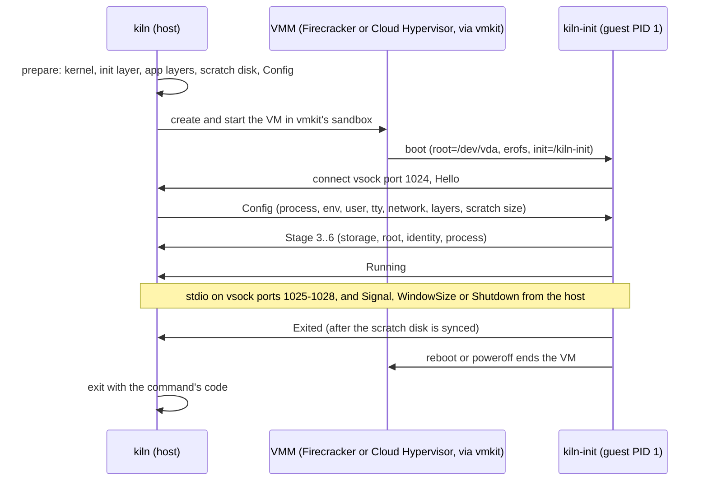

# Running images: `kiln run`

`kiln run IMAGE [CMD...]` boots a kiln image in a microVM on Linux with KVM and runs its command (or `CMD`, which replaces the image's cmd; the entrypoint stays), as `docker run` would. On macOS it prints how to use the Lima VM (below) and exits 125.

```bash
K="--init kiln-init --allow-custom-init"        # until kiln pins a released kiln-init (see "What boots")
kiln run $K alpine:3 -- sh -c 'echo hello'      # exit code, stdout and stderr as with docker run
echo hi | kiln run $K -i alpine:3 -- cat        # -i relays stdin; without it stdin is at EOF
kiln run $K -t -i alpine:3                      # a terminal: Ctrl-] q stops the guest, Ctrl-] k kills it
```

`kiln-init` here is the path to a static `kiln-init` binary; [testing.md](testing.md#building-kiln-init) shows how to build one.

## What a run does



The host side of one `kiln run` and the control protocol between kiln and kiln-init. The normative description is [format.md](format.md#control-protocol-version-1).

## Signals, stopping and exit codes

- The first SIGINT or SIGTERM asks the guest to stop (`STOPSIGNAL`, then SIGKILL after `--stop-timeout`, default 10 s); a second SIGINT kills the VM. kiln kills the VM itself only when the guest has not reported its exit 10 s after the stop timeout (60 s with `--persist`): the guest syncs its disk before it reports. Without a stop request, a guest stuck before it reports its exit (in that sync, say) is treated like a command that still runs: kiln waits, as `docker run` does, and Ctrl-C twice kills it. SIGHUP, SIGQUIT, SIGUSR1 and SIGUSR2 are forwarded to the command.
- Exit codes: the command's, or `128 + signal`; 127 and 126 when the entrypoint is missing or not executable; 137 when you killed the VM, as with `docker kill`; 125 when kiln, the VM or the guest's init failed, including the `--boot-timeout` (default 30 s), with the end of the guest's console.
- Usage errors of `kiln run` exit 125, as `docker run`'s do. An interrupt (SIGINT, SIGTERM, or SIGHUP when the terminal goes away) while kiln is still setting the VM up stops the setup, removes what it made and exits 137; SIGQUIT, SIGUSR1 and SIGUSR2 then are not forwarded once the command runs, and kiln says so.
- Signals are 1 to 31. An image whose `STOPSIGNAL` is a real-time signal is refused.

## Flags

- `--vmm firecracker|cloud-hypervisor` (default Firecracker), `--cpus N` (default 1), `--memory MiB` (default 512), `--disk SIZE` (the scratch disk, default 4G), `-e KEY[=VALUE]`, `--stop-timeout SECS`, `--boot-timeout SECS`.
- kiln's flags go before IMAGE: as with `docker run`, everything after IMAGE is the command, flags included (`kiln run img -i` runs `-i`), and a `--` right after IMAGE is optional.
- IMAGE is a name or digest in the store. Names also match by their normalised reference (`alpine:3` finds `docker.io/library/alpine:3`).

## Networking

- `--net` gives the guest `eth0` (`172.30.0.2/30`, gateway and DNS `172.30.0.1`; and `fd76:6d6b:6974::2/64`, gateway `fd76:6d6b:6974::1`) in the VM's own network namespace, with egress through the host by `pasta`. Both are NAT'd: the guest reaches IPv6 destinations when the host has IPv6, and resolvers prefer IPv4 for names that have both. DNS is on the IPv4 gateway and still answers AAAA queries. Without `--net` the guest has only loopback, and its `/etc/resolv.conf` names `127.0.0.1`, so lookups fail at once.
- `--egress` sets what the guest may reach:
  - `restricted` (the default): no private, link-local or cloud metadata, CGNAT, loopback or multicast ranges, and none of the host's own addresses. For IPv6: nothing outside global unicast `2000::/3` (ULA, link-local, multicast, loopback, IPv4-mapped, NAT64), no Teredo, 6to4 or documentation prefixes, none of the host's IPv6 addresses, and none of the networks the host reaches directly (its LANs);
  - `deny-all`: DNS only;
  - `open`: everything, with a warning;
  - `allow=CIDR` exceptions, IPv4 or IPv6 (repeatable). One that opens cloud metadata or a whole private, CGNAT or link-local range, or everything, is warned about as `open` is; exceptions given with `open` are ignored, with a warning.
- pasta gives the VM's namespace the host's outbound addresses (the ones on its IPv4 and IPv6 default routes), so the guest can never reach them: an exception for one alone is refused, and a wider one that includes one is warned about. The host's other addresses can be reached through an exception.
- `-p [ADDRESS:]HOST:GUEST[/tcp|udp]` (repeatable, with `--net`) publishes a guest port on the host, over IPv4 only. The address defaults to `127.0.0.1`, unlike Docker's `0.0.0.0`: a published port stays on this machine unless you give `-p 0.0.0.0:8080:8080` (or another of the host's addresses). A host port below 1024 needs privileges kiln does not have (pasta binds it as you): publish a high port, `-p 8080:80`, rather than `-p 80:80`. The image decides which port its app listens on, and the app must listen on `0.0.0.0` (or the guest's address) at the guest port: a forward to an app listening on `127.0.0.1` cannot work, and its connections end at once.

## Persistent disks

`--persist PATH` keeps the scratch disk (everything the guest wrote over the image) in the file PATH across runs, with a sidecar `PATH.kiln.json` naming the image and its layers, written once the guest runs the command (a run that fails to boot leaves the old one, or none for a disk it created).

- A disk is reused only with the same app layers in the same order, since overlayfs cannot keep files over other layers; another manifest with the same layers (a changed env or cmd) reuses it, with a note.
- `--persist-reset` recreates it and `--persist-force` reuses it anyway, with a warning (but never a disk whose sidecar a newer kiln wrote).
- It is never shrunk (a smaller `--disk` is refused; a larger one grows it), two runs never share it, and kiln never removes it.

## What boots

kiln compiles in a table of the kernels (vmkit's releases) and kiln-init binaries (kiln's) it trusts, by digest.

- `kiln convert` adds a kernel layer and an init layer for each one the table pins for the image's architecture, fetched once by digest. `kiln inspect` shows them on its `boot:` line; without them the image is provisional, and convert says what `kiln run` will need.
- `kiln run` boots an image's kernel layer only when it is the pinned one for the profile and version its config names, and always replaces the image's init layer with the pinned kiln-init's. Neither needs the network once fetched, and `kiln gc` keeps them. An image's own init layer never boots.
- The table pins vmkit's `kernels-6.18.54` release (profile `base`, arm64 and amd64, from `ghcr.io/alfonsocampodonico/vmkit-kernels/base`) and no kiln-init yet: until one is released, `--init PATH --allow-custom-init` names it. The kernel is fetched anonymously from ghcr.io (with your Docker credentials only if it demands them).
- Offline, or behind an HTTPS proxy (kiln's registry client does not use one), `kiln convert --boot-layers none` makes a provisional image without boot layers, which `kiln run` boots with `--kernel PATH --allow-custom-kernel` (kiln-init comes from the pin, or `--init`, as for any image). An image converted before the kernel was pinned has no kernel layer either: convert it again, or boot another kernel with `--kernel PATH --allow-custom-kernel`.
- Custom kernels and inits are warned about and recorded in the run's `run.json`.

## Run state on disk

- Per-run state (`run.json`, the VMM's sockets and logs, `console.log`) lives in `$XDG_RUNTIME_DIR/kiln/<id>/` (or `/tmp/kiln-<uid>/<id>/`), mode 0700.
- The scratch disk is not kept there, since that directory is usually a tmpfs whose pages would hold the guest's disk in memory: it is in `$KILN_HOME/scratch/<id>/` (mode 0700, on the store's filesystem), and goes with the run; `kiln gc` leaves it alone.
- `KILN_KEEP_RUN_DIR=1` keeps both directories, and `KILN_TIMINGS=1` prints how long booting took.
- A later run removes the directories of a run whose kiln was killed, once neither kiln nor its VMM runs, and first kills such a run's VMM if it still runs (nothing can use it without its kiln). A scratch directory records whose it is (`scratch.json`), so it is removed even when a reboot or logout has already emptied the run directory.

## On macOS: the Lima VM

`lima/kiln.yaml` is a Lima VM with nested KVM (an Apple M3 or later, macOS 15 or later) with Firecracker, Cloud Hypervisor, pasta and nftables installed, and the Mac's store (`~/.local/share/kiln`, which `kiln convert` creates) mounted read-only at `/mnt/kiln-store`. Install `kiln` and `vmkit-sandbox` in the VM's `/usr/local/bin` (until releases exist, build them there); the template's AppArmor profile lets that `vmkit-sandbox` create user namespaces.

```bash
limactl start --name kiln lima/kiln.yaml
kiln convert php:8.4-cli                                         # on the Mac
limactl shell kiln kiln run $K php:8.4-cli -- php -v             # in the VM
limactl shell kiln kiln run $K --net -p 8080:8080 app:1          # then, on the Mac: curl localhost:8080
```

- The VM keeps its own store (Unix sockets and `flock` are not reliable on shared mounts). `KILN_IMPORT_FROM=/mnt/kiln-store` is set there, so `kiln run` first imports the image from the Mac's store when that store has it, copying only missing blobs and tagging it again every time: the latest convert on the Mac is what runs.
- A port published on the VM's `127.0.0.1` (the `-p` default) reaches the Mac's `localhost`: Lima forwards the VM's loopback listeners to the Mac's `127.0.0.1` (IPv4; if something on the Mac already listens on that port over IPv6, `localhost` may reach it instead). Nothing else on the Mac's network sees it.

## Known limitations

- Cloud Hypervisor 53 cannot grow the scratch disk online beyond about 8 GiB (the resize hangs), and under nested virtualization (Lima on Apple Silicon) growth is unreliable at any size. Firecracker grows it to 64 GiB and is the reference VMM. kiln's default disk is 4 GiB.
- Under nested virtualization (Lima on Apple Silicon), Cloud Hypervisor 53 guests sometimes stall, more often in vsock-heavy cases (stdio streaming, protocol abuse); rerun the failed cases there.
- The guest differs from a Docker container in a few deliberate ways (init is PID 1, `/sys` and cgroup2 are read-write, `/dev` is the full devtmpfs); see [format.md](format.md#differences-from-docker).
